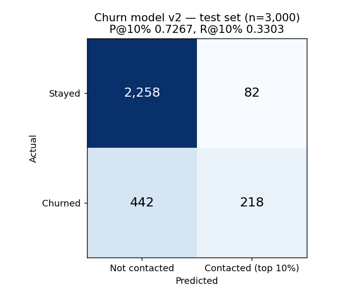
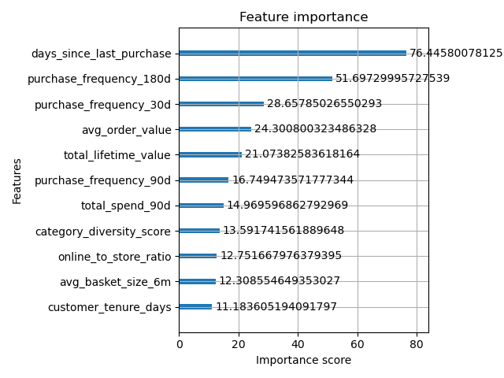

# Lab 3 — Task 1 Evaluation Report: Churn Prediction Model (Track A)

All numbers come from the graded run `xgb-d3-eta0.05-final` (Model Registry `northstar-churn-models` **version 2**, `PendingManualApproval`, registered 2026-10-14). Sources:
- [`lab3-evidence/evaluation_metrics.json`](lab3-evidence/evaluation_metrics.json)
- [`lab3-evidence/slice-evaluation.csv`](lab3-evidence/slice-evaluation.csv)
- [`lab3-mlflow-runs.txt`](lab3-mlflow-runs.txt)
- [`lab3-model-registry.txt`](lab3-model-registry.txt)

## 1. Setup

| Item | Value |
|---|---|
| Data source | SageMaker Feature Store offline store `northstar-dev-customer-features`, queried via Athena (deduplicated on `customer_id` by latest `event_time`, `ORDER BY customer_id` for a reproducible split) |
| Rows | 9,999 customers, 22.0% churners |
| Split | Stratified 70/30, `random_state=42` → 6,999 train / 3,000 test (660 churners in test) |
| Features | 11 (`FEATURE_COLUMNS`). `churn_label` and `customer_id` excluded; `loyalty_tier` used only for slicing |
| Model | XGBoost **3.2.0**, trained locally (not the SageMaker 1.7 container) |
| Final hyperparameters | `max_depth=3`, `eta=0.05`, `num_round=400` (early stopping after 20 rounds without validation-AUC gain), `min_child_weight=5`, `subsample=0.8`, `colsample_bytree=0.8`, `scale_pos_weight=3.545` |
| Registered model | `northstar-churn-models` **version 2**, status `PendingManualApproval` |

**Model versions.** Version 1 in the registry is the first registered candidate (depth 6, eta 0.1). Version 2 is the final model, chosen after the experiment in §3.

**XGBoost version.** The model was trained on XGBoost 3.2.0, so the lab's 3.2.0 reference column is the right comparison. The SageMaker 1.7 container produces slightly different numbers on identical data.

**Leakage controls.**
- Every feature is computed only from purchases on or before T = 2026-04-01.
- `churn_label` comes from the outcome window (T, 2026-06-30] and is never an input.
- `churn_risk_score` is **excluded** from the feature set because it is a pure recency heuristic. Since it isn't used, no with/without comparison is needed.

**Missing values.** Features are filled with a −1 sentinel (`fillna(-1)`). The Lab 2 verification showed 0 nulls in the feature table, so the sentinel is defensive and was never exercised.

**Known limitation.** Early stopping monitors AUC on the same 30% split that the metrics below are reported on. That lets the test set choose the number of boosting rounds, which can bias the reported metrics slightly upward. A clean protocol would carve a separate validation split out of the 6,999 training rows.

## 2. Evaluation (test set, n = 3,000)

| Metric | Value | Threshold | Result |
|---|---|---|---|
| AUC-ROC (full model) | **0.7840** | reported, no threshold | — |
| Precision @ top 10% | **0.7267** | ≥ 0.50 | ✅ PASS |
| Recall @ top 10% | **0.3303** | ≥ 0.25 | ✅ PASS |
| Recency-only baseline AUC | 0.7223 | — | — |
| **AUC lift over baseline** | **+0.0617** | 95% CI must exclude 0 | ✅ **[0.0416, 0.0795]** |

**How these were measured:**
- **Baseline:** an XGBoost model trained on `days_since_last_purchase` alone, using the same train and test rows (not a constant predictor).
- **Confidence interval:** a paired bootstrap. The test set was resampled with replacement 2,000 times, both models were scored on each resample, and the interval runs from the 2.5th to the 97.5th percentile of the AUC difference. It is paired because resampling the two models independently would inflate the interval.

**Reading the results:**
- **The features do real work.** The whole interval lies above zero, which is evidence that the engineered features add signal beyond recency.
- **Comparison with the lab reference** (also XGBoost 3.2.0): the reference measured 0.7696 full vs 0.7233 baseline, a lift of +0.0464 [0.0254, 0.0670]. This model's lift is larger, and its interval overlaps the reference's.
- **Recall in context:** with 22% churners, a top-10% contact list can capture at most about 45% of churners (300 of 660). A recall of 0.330 means this model captures about 73% of what that budget can reach.

## 3. Experiment tracking (SageMaker MLflow App)

MLflow App: `arn:aws:sagemaker:us-east-1:342973270367:mlflow-app/app-MZTP7BFTQXKN`, experiment `northstar-churn`. Full `mlflow.search_runs` output: [`lab3-mlflow-runs.txt`](lab3-mlflow-runs.txt).

| Run | max_depth | eta | scale_pos_weight | AUC | P@10% | R@10% | Lift CI low | Question it answers |
|---|---|---|---|---|---|---|---|---|
| xgb-d6-eta0.1 | 6 | 0.10 | 3.545 | 0.7764 | 0.7033 | 0.3197 | 0.0346 | Starting configuration |
| **xgb-d3-eta0.05** | **3** | **0.05** | 3.545 | **0.7840** | **0.7267** | **0.3303** | 0.0416 | Does a shallower, slower model generalise better on ~7k rows? |
| xgb-d6-noweight | 6 | 0.10 | **1.0** | 0.7833 | 0.7133 | 0.3242 | 0.0419 | What does class weighting buy? |

A fourth run, `xgb-d3-eta0.05-final`, re-ran the chosen configuration with `--register` to produce registry version 2. Its metrics are identical to `xgb-d3-eta0.05`.

**Interpretation:**
- **The three runs are effectively tied.** Their AUCs sit within 0.008 of each other, and the lab measured AUC moving ±0.03 across random splits of this data. The ranking between them isn't meaningful.
- **I chose depth 3 / eta 0.05 because it is at least as good and simpler.** Shallower trees are easier to explain to the retention team and carry less overfitting risk on 6,999 rows. Simplicity is the tie-breaker, not the 0.008 AUC difference.
- **Class weighting:**
  - `scale_pos_weight = 3.545` is the ratio of negatives to positives in the *training* split. It is computed from the data, not hard-coded.
  - The unweighted run (`scale_pos_weight = 1.0`) did **not** score worse on AUC or the top-10% metrics. That is expected: these are ranking metrics, and reweighting mainly rescales predicted probabilities rather than reordering customers.
  - I kept the weighting because the business may later act on a probability threshold (e.g. 0.5), and an unweighted model trained on 22% positives would under-predict churn there. It is not kept because it improved AUC; it didn't.

## 4. Confusion matrix (operating point: top 10% of the test set, 300 customers)



|  | Not contacted | Contacted (top 10%) |
|---|---|---|
| **Actual: stayed** (2,340) | TN = 2,258 | FP = 82 |
| **Actual: churned** (660) | FN = 442 | TP = 218 |

The cells follow exactly from the graded run's metrics: TP = 0.7267 × 300 = 218 = 0.3303 × 660, FP = 300 − 218, FN = 660 − 218, and TN is the remainder.

**Why the operating point is "top 10%" rather than a 0.5 probability cutoff:** the retention team has a fixed contact budget, so the operational question is "who are the 300 riskiest customers?" Of the 300 contacted, 218 actually churn (precision 0.73). The cost is 442 churners left uncontacted, which the size of the budget limits.

## 5. Feature importance



| Rank | Feature | Gain |
|---|---|---|
| 1 | days_since_last_purchase | 76.4 |
| 2 | purchase_frequency_180d | 51.7 |
| 3 | purchase_frequency_30d | 28.7 |
| 4 | avg_order_value | 24.3 |
| 5 | total_lifetime_value | 21.1 |
| 6 | purchase_frequency_90d | 16.7 |
| 7 | total_spend_90d | 15.0 |
| 8 | category_diversity_score | 13.6 |
| 9 | online_to_store_ratio | 12.8 |
| 10 | avg_basket_size_6m | 12.3 |
| 11 | customer_tenure_days | 11.2 |

- **Recency is still the single strongest feature**, as expected.
- **The lift over the baseline comes mainly from frequency (180-day, 30-day) and monetary value** (average order value, lifetime value).
- **The behavioural features look weak.** Lab 2 built `category_diversity_score`, `online_to_store_ratio` and `avg_basket_size_6m` specifically to catch churners who still look active. They rank 8th–10th, and only tenure ranks lower. By this measure they look largely decorative.
- **Caveat:** gain importance isn't proof of contribution, because correlated features split credit. The proper test is an ablation: retrain without the three behavioural features and see whether the lift interval moves.

## 6. Slice evaluation across loyalty tiers

Data: [`lab3-evidence/slice-evaluation.csv`](lab3-evidence/slice-evaluation.csv).

**Method:**
- Recall@10% uses the **global** top-10% cutoff, because the business has one contact budget. A tier's recall is the share of its churners that fall inside that single budget.
- A tier is flagged for low recall if its recall is more than 10 percentage points below the aggregate (0.330).
- A tier with fewer than 30 test churners is treated as too small to support a claim.

| Tier | Test n | Churners | Churn rate | AUC | Recall@10% | Churners caught | Flag |
|---|---|---|---|---|---|---|---|
| Bronze | 1,071 | 361 | 33.7% | 0.759 | 0.454 | 164 | — |
| Silver | 1,139 | 226 | 19.8% | **0.714** | 0.190 | 43 | ⚠ low recall · **weakest AUC** |
| Gold | 483 | 52 | 10.8% | 0.753 | 0.115 | 6 | ⚠ low recall · borderline n |
| Platinum | 307 | 21 | 6.8% | 0.878 | 0.238 | 5 | ⚠ **too small to conclude** |
| **All** | 3,000 | 660 | 22.0% | 0.784 | 0.330 | 218 | |

**Discussion:**
1. **The weakest tier is Silver** (AUC 0.714, the lowest of the four). It is also the *largest* tier in the test set (1,139 customers, 226 churners), so this is a real finding, not noise. A hypothesis, not yet tested: Silver may hold a larger share of the churners who keep buying right up to T, whose recency looks healthy, and that is the group the model is weakest on.
2. **Platinum is too small to conclude anything.** Its AUC of 0.878 looks like the best tier, but it rests on 21 churners, and its recall of 0.238 is 5 of 21 customers: one more caught would move it by about 5 percentage points. In the depth-6 run, Platinum recall was 0.095 (2 of 21), a 2.5× swing caused by 3 customers. I draw no conclusion about Platinum.
3. **Gold is borderline** (52 churners). Its numbers are indicative only.
4. **Low Gold and Platinum recall is mostly a budget effect, not a model failure.** Their churn rates (10.8% and 6.8%) are far below Bronze's 33.7%, so under one global budget the riskiest customers overall are mostly Bronze. AUC, which measures ranking quality *within* a tier, is the fairer per-tier measure, and Gold's and Platinum's AUCs are fine.
5. **Business implication:** the global top-10% policy contacts almost none of the at-risk Gold and Platinum customers (6 of 52 and 5 of 21), who are the most valuable ones. Fixes would be to rank by expected lost value (p(churn) × lifetime value) or to set per-tier contact budgets.

## 7. Reproducing

```bash
python churn_training_skeleton.py --artifacts-bucket northstar-dev-data-342973270367 \
  --max-depth 3 --eta 0.05 --num-round 400 \
  --mlflow-arn arn:aws:sagemaker:us-east-1:342973270367:mlflow-app/app-MZTP7BFTQXKN \
  --run-name xgb-d3-eta0.05 [--register]
```

**Outputs:**
- `output/evaluation_metrics.json`
- `output/slice_metrics.json`
- `docs/lab3-feature-importance.png`
- The model artifact at `s3://northstar-dev-data-342973270367/artifacts/models/churn/<timestamp>/model.tar.gz`

**Known gap:** the model was trained on XGBoost 3.2.0 but registered against the SageMaker `xgboost:1.7-1` image. It is saved as JSON for compatibility, but it hasn't been deployment-tested; deployment is Lab 5.
